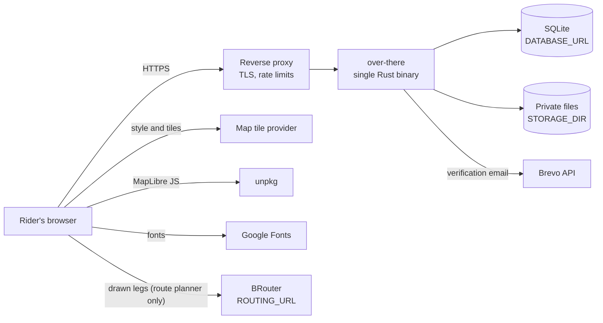
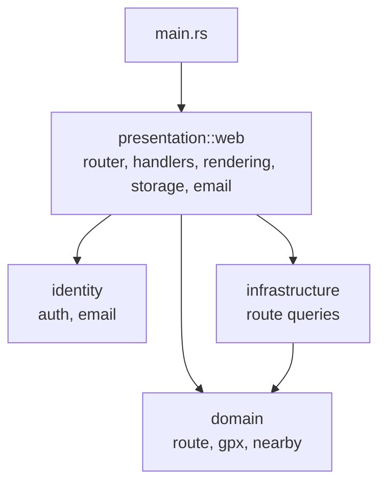
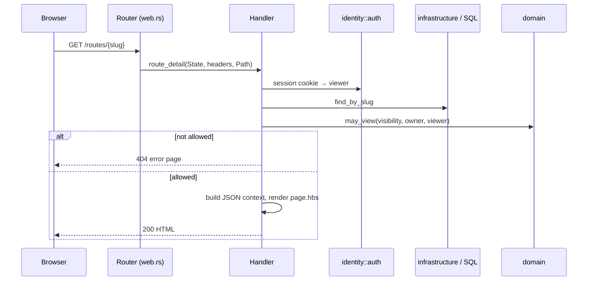

# Over There — architecture and MVP decisions

## Product reading

Over There is a public library of GPX routes, starting with cycling. A visitor finds a ride by place and effort, studies the line and elevation, then downloads the original file. A contributor uploads a GPX or draws a route on the map, checks derived facts, chooses visibility, and maintains a public profile. Drawing is a small planner: clicked points joined along roads by BRouter, saved as an ordinary route whose line the owner can edit later ([design](specs/2026-10-21-draw-route-design.md)). There is no feed, following system, turn-by-turn directions, or navigation.

The [Komoot home page](https://www.komoot.com/) demonstrates how activity and destination browsing, map context, route difficulty, and clear route presentation aid discovery. Its planning, navigation, and social features are outside this MVP. The supplied [CariRute URL](https://gpx.ai.id/) was unavailable to the research tool on 20 October 2026, so no specific claim about its current features informs this design.

## System overview

This section is the map of the running system. The rest of this file records the decisions behind it. Reference details live in separate files:

- [data-catalog.md](data-catalog.md): every table, column, stored file and sensitivity class
- [service-catalog.md](service-catalog.md): every module, browser script and external service, with its interface and failure mode
- [contracts.md](contracts.md): HTTP endpoints, cookies, CSRF, file formats, template-to-script data and configuration

### Context



The server holds all state and renders every page. The browser talks to third parties only for the map library, map tiles, fonts and, while a rider draws a route, the BRouter routing service, which sees the points they place. Tile requests reveal which area a viewer is looking at, including around a private route, so choose a production tile provider whose privacy terms you accept.

### Layers



The dependency rule: arrows point toward `domain`, never away from it. Domain code takes and returns plain values, so it has no HTTP or SQL and is tested without a server. `identity::auth` is the one deliberate exception below the web layer: it reads cookies from request headers and queries `sessions`, because sessions are meaningless without both.

### Folder structure

```text
Over-There/
├── Cargo.toml            # crate name, Rust edition, dependencies
├── Cargo.lock            # exact dependency versions (committed, used by --locked)
├── .env.example          # settings read at startup; copy to .env
├── migrations/           # SQL files applied in filename order on startup
├── resources/            # data compiled into the binary (disposable email domains)
├── templates/page.hbs    # the one Handlebars template, with a section per page
├── static/               # CSS, browser JS (maps, elevation chart), images, map style
├── scripts/              # helper scripts, not part of the server
├── docs/                 # architecture, catalogs, contracts, roadmap, specs, plans, Rust guide
├── data/                 # created at runtime: SQLite DB + uploaded files (never committed)
└── src/
    ├── main.rs           # entry point: declares modules and starts the server
    ├── domain/           # pure business rules, no HTTP and no database
    │   ├── mod.rs
    │   ├── gpx.rs        # parse GPX, distance, elevation, endpoint hiding, GeoJSON
    │   ├── route.rs      # visibility, who may view/edit, form validation, slugs
    │   └── nearby.rs     # "routes near me": bounding boxes, distance, ranking
    ├── identity/         # accounts
    │   ├── mod.rs
    │   ├── auth.rs       # password hashing, sessions, cookies, CSRF
    │   └── email.rs      # email validation and the disposable-domain check
    ├── infrastructure/   # database access for routes
    │   ├── mod.rs
    │   └── routes.rs     # RouteRecord and SQLx queries
    └── presentation/     # the HTTP layer
        ├── mod.rs
        └── web.rs        # startup, URL router, handlers, templates, HTTP tests
```

### Request lifecycle



Every handler follows this shape: identify the viewer, check CSRF on POST, load data, apply a domain rule, then render or redirect. Errors at any step become an `AppError`, which renders as an HTML error page with the right status code.

### Where new work goes

| Adding… | Put it in | Also update |
| --- | --- | --- |
| A business rule (validation, access, a calculation) | `src/domain/`, with a unit test | [service-catalog.md](service-catalog.md) |
| A table or column | A new file in `migrations/` (never edit an applied one) | [data-catalog.md](data-catalog.md) |
| A page or endpoint | A handler and `.route(...)` in `web.rs`, a `page_*` section in `templates/page.hbs` | [contracts.md](contracts.md) |
| A reusable query | `src/infrastructure/` once a second caller needs it | [service-catalog.md](service-catalog.md) |
| Browser behaviour | A small script in `static/`, loaded only on its page | [contracts.md](contracts.md#template-and-script-contract) |
| A third-party service or env variable | Read it in `web::run`, add it to `.env.example` | [service-catalog.md](service-catalog.md#external-services), [contracts.md](contracts.md#configuration) |

When `web.rs` gets hard to navigate, split it by feature (discovery, routes, accounts, admin) as listed in the [service catalog](service-catalog.md#web-application). When the app needs a second process, such as a worker for email or image processing, the service catalog entry for that module is its starting interface.

## Stack decision

| Option | Rust learning and upkeep | SSR/SEO | Maps | Deployment | Decision |
| --- | --- | --- | --- | --- | --- |
| Leptos full stack SSR | Shared Rust types and reactive UI; more macros, hydration, WASM and feature gates to learn | Strong | JS interop needed for MapLibre | Rust server plus WASM bundle | Good future option |
| Leptos + Axum | Flexible HTTP endpoints with Leptos UI; largest integration surface | Strong | JS interop needed | Same two build targets | Useful when client reactivity grows |
| Axum API + separate frontend | Familiar separation, more duplication and client state | Requires another SSR framework | Straightforward | Two applications | Too much for a solo MVP |
| **Axum + Handlebars SSR + small JS islands** | **Direct Rust request/data flow, ordinary templates, smallest build** | **Strong** | **MapLibre on detail pages** | **One binary plus assets** | **Selected** |

Axum and its multipart support are documented in the [official crate docs](https://docs.rs/axum/latest/axum/). [Leptos SSR deployment](https://book.leptos.dev/deployment/ssr.html) entails a server build and a client WASM build. MapLibre is a browser WebGL library with [GeoJSON sources, map bounds, navigation and fullscreen controls](https://maplibre.org/maplibre-gl-js/docs/). Keeping the map in JavaScript is a practical boundary, not a loss of application logic to JavaScript.

SQLite is selected for a single affordable server. WAL mode and indexed, paginated queries are enough for an initial route library. PostgreSQL becomes appropriate for multiple writers, replicas, geographic search, or significant moderation traffic. SQLx gives async queries and migrations; this code uses runtime bound queries because they work without a build-time database. The original GPX and processed images live under a private storage root and are served through authorization checks. A storage trait can be introduced when object storage is actually needed.

GPX is parsed with `roxmltree`, DTD disabled and a node limit, so the service has explicit control over track segment boundaries and missing fields. The [parser's documented defaults](https://docs.rs/roxmltree/latest/roxmltree/struct.ParsingOptions.html) reject DTDs. Passwords use `ring` PBKDF2-HMAC-SHA256 with per-user random salt; session tokens are random and only their SHA-256 digest is stored. Image uploads are decoded and re-encoded to WebP to discard metadata and avoid serving untrusted source formats.

MapLibre renders simplified GeoJSON. The original remains intact for downloads. The default OSM raster style is for development and modest testing; public deployment must configure a suitable tile service and respect the [OSM tile usage policy](https://operations.osmfoundation.org/policies/tiles/). Route previews use generated vector thumbnails, so discovery does not load dozens of live maps.

## Domain boundaries

The code uses a pragmatic domain driven design. `src/domain/route.rs` owns route validation, visibility and access rules; `src/domain/gpx.rs` owns GPX geometry and derived facts. `src/identity/auth.rs` owns password and session mechanics; `src/identity/email.rs` owns email validation and the local disposable-domain check. `src/infrastructure/routes.rs` maps the persisted route record and queries it with SQLx. `src/presentation/web.rs` is the HTTP adapter: it reads forms, calls domain rules, coordinates persistence and storage, and renders templates. The database schema stays explicit and serves as the boundary for future extraction of more repository methods. New activity types should enter through the route domain, and new storage services should replace the file adapter without changing GPX computation or access rules.

This is deliberately a small domain model rather than a forest of traits and generic repositories. The tests focus on domain invariants: private access, segment boundaries, incomplete metrics, DTD rejection and endpoint hiding.

## Data and visibility

The schema has users, sessions, routes, route_images, photo_likes, route_reports and email_verifications; every column is described in the [data catalog](data-catalog.md). A route owns its GPX file and public geometry. Category (`cycling`) is separate from cycling type so hiking and running can be added without changing route ownership. `visibility` is one of public, unlisted and private. Public discovery queries only `public`; unlisted detail and GPX require possession of the unguessable slug; private detail and downloads require owner or administrator. Map geometry, image endpoints and the photo gallery follow the same gate. Other riders may add photos only to public and unlisted routes whose owner left `photos_open` on; the owner may always add to their own. A photo is deleted by the rider who added it or an administrator, never by the route owner, who reports it instead ([design](specs/2026-10-21-community-photos-design.md)). Email verification and contributor verification are distinct fields; only an administrator sets the contributor flag. Each route also stores the bounding box of its public geometry (`min_lat`, `max_lat`, `min_lon`, `max_lon`); nearby search prefilters by that box and measures distance only to the public, endpoint-trimmed line, never the original GPX. The rider's location arrives rounded to two decimals, is never stored, and request logs record paths without query strings ([design](specs/2026-10-20-nearby-routes-design.md)).

The uploader controls endpoint hiding before public sharing. When enabled, a published geometry copy omits a user-selected radius from each end; the original GPX stays private to the owner and the public download is a generated redacted GPX. The interface must make this distinction explicit. The initial implementation should never expose raw file paths or GPS data through predictable static URLs.

## Primary flows and page structure

1. Visitor: home → explore (a map, plus the nearest public routes when the rider shares a location) with title/region/type/difficulty/distance/sort → route detail/map/profile → GPX download.
2. Contributor: register (email verification optional; unverified accounts publish up to 5 routes a day, forms carry a hidden honeypot field) → upload GPX → review computed metrics and privacy → publish → dashboard/edit. Any signed-in rider can add up to 5 photos to another rider's open route and like photos.
3. Moderator: admin report queue → inspect route or photo → make the route private, remove the photo, or dismiss → manage contributor badge.

Navigation has Explore, Share, Dashboard (when signed in), and account access. The landing page uses a cycling photo in a route field note and a second wide ride photo, with short copy. The brand palette is black `#0F0F0F`, electric lime `#C6FF2D`, white `#FFFFFF`, charcoal `#2F2F2F` and gray `#808080`, with Manjari for headings and Inter for text; see the [UI refresh design](specs/2026-10-20-ui-refresh-design.md). Every color is a token in the `:root` block of `static/style.css`. Lime is a fill behind black text or a color on black, never text on a light background, and small muted text uses the darker `--muted` gray. Route previews still come from each GPX or contributor photo. Reusable elements are the navigation shell, route preview, metric row, state label, form field, map, and elevation profile. On phones, the explore filters become a stacked form and the map precedes route details.

## Delivery order and deployment

1. Core: schema, authentication, GPX parser, storage and ownership checks.
2. Routes: upload/edit/delete, public discovery, detail, geometry and download.
3. Identity: profiles, account settings, verification and image handling.
4. Trust: reports, moderation and contributor badges.
5. Operate: tests, Docker, backups, logging, rate limits and production configuration.

For a single host, back up the SQLite database with its online backup mechanism and the entire private storage directory as one coordinated snapshot. Restore both together. Put TLS and request rate limiting at the reverse proxy and set a production map style and email provider. The app also enforces upload size and authorization internally. See the README for executable setup.

## Rust concepts in this implementation

Handlers borrow shared state through Axum's `State<Arc<AppState>>`; the pool and template registry are shared safely without copying their internals. GPX parsing borrows the XML text while walking nodes, then creates owned route data before the document is dropped. `Result` and `?` propagate parse, database, and filesystem errors; user input errors are turned into 4xx responses at the HTTP boundary. Structs for parsed geometry and route records keep domain invariants explicit without a large repository or trait hierarchy. For a guided tour of these concepts with examples from the code, see [learning-rust.md](learning-rust.md).
