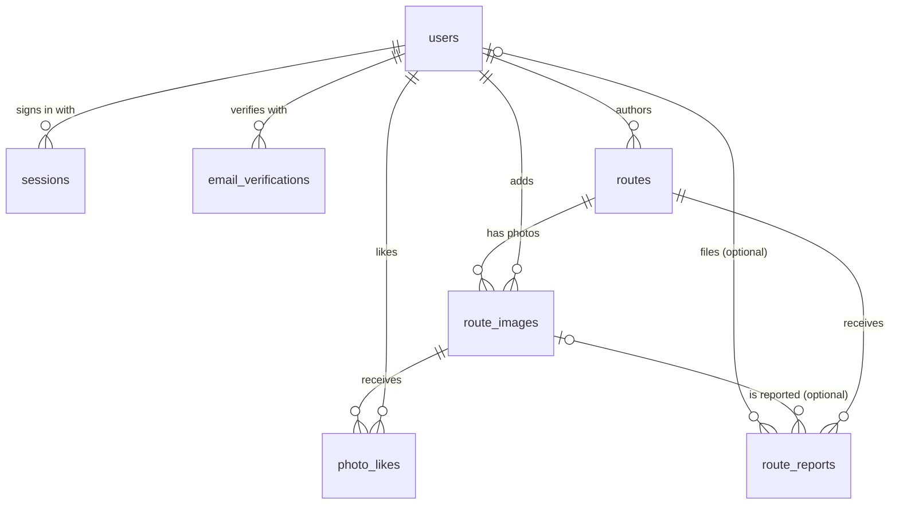

# Data catalog

Every piece of data Over There stores: where it lives, what it means, where it comes from, and who may see it. Update this file in the same pull request as any migration, new stored file type, or change to how a column is derived.

- Schema source of truth: [`migrations/`](../migrations), applied in filename order on startup by `sqlx::migrate!()`.
- Database: one SQLite file (`DATABASE_URL`, default `data/over-there.db`), WAL mode, foreign keys on.
- Files: one flat private directory (`STORAGE_DIR`, default `data/files`). It is never served directly.

## Sensitivity classes

| Class | Who may see it | Examples |
| --- | --- | --- |
| **Public** | Anyone | username, bio, public route metadata |
| **Gated** | Whoever passes `domain::route::may_view` for the route (public: anyone; unlisted: anyone with the slug; private: owner or admin) | geometry, elevation, photos, visitor GPX |
| **Owner** | The route owner and administrators | original GPX of a route with hidden endpoints |
| **Personal** | The person themself and administrators | email address, verification state |
| **Admin** | Administrators only | report queue, user list |
| **Secret** | Never leaves the server, not even to admins in the UI | password hash, session and token hashes, CSRF tokens |

## Conventions

- **IDs** are UUID v4 strings (`TEXT`).
- **Timestamps** are `TEXT` in SQLite's `YYYY-MM-DD HH:MM:SS` UTC format, written with `datetime('now')`.
- **Booleans** are `INTEGER` 0/1 (`is_admin`) or a nullable timestamp, where "set" means true (`email_verified_at`).
- **Distances** are metres (`REAL`), **durations** seconds (`INTEGER`), **coordinates** WGS84 degrees.
- **Storage keys** (`*_key` columns) are file names inside `STORAGE_DIR`: `{uuid}.gpx` or `{uuid}.webp`. They never appear in URLs.

## Entity overview

`auth_attempts` and `email_send_quota` are standalone counters with no foreign keys. `pending_tasks` lists one-off startup jobs (`name TEXT PRIMARY KEY`); a row is deleted once its job has run.

## Tables

### `users`

Accounts. Written by `presentation::web` (register, verify, account, admin); read through `identity::auth::User`.

| Column | Type | Null | Meaning and rules | Class |
| --- | --- | --- | --- | --- |
| `id` | TEXT PK | no | UUID v4. Appears only in admin form URLs | Admin |
| `username` | TEXT UNIQUE NOCASE | no | 3–32 chars of `a-z 0-9 _`, lowercased at registration; fixed after that. Used in `/users/{username}` | Public |
| `email` | TEXT UNIQUE NOCASE | no | Lowercased, checked by `identity::email::validate`, disposable domains rejected | Personal |
| `password_hash` | TEXT | no | `iterations:salt_hex:hash_hex`, PBKDF2-HMAC-SHA256, 310,000 iterations, 16-byte random salt | Secret |
| `bio` | TEXT | no | Up to 300 chars, default `''` | Public |
| `avatar_key` | TEXT | yes | Storage key of a 512 px WebP | Public (via `/users/{username}/avatar`) |
| `email_verified_at` | TEXT | yes | Set by `/verify/{token}`. Optional: without it an account may publish 5 routes per rolling day. Required to receive the contributor badge | Personal |
| `contributor_verified_at` | TEXT | yes | Badge, set or cleared only by an administrator | Public |
| `is_admin` | INTEGER | no | 0/1, default 0. There is no UI to change it; set it with `sqlite3` | Personal |
| `created_at` | TEXT | no | Registration time | Personal |

### `sessions`

One row per signed-in browser.

| Column | Type | Null | Meaning and rules | Class |
| --- | --- | --- | --- | --- |
| `token_hash` | TEXT PK | no | SHA-256 hex of the `ot_session` cookie value. The raw token is never stored | Secret |
| `user_id` | TEXT FK → users | no | `ON DELETE CASCADE` | Secret |
| `csrf_token` | TEXT | no | 64 hex chars, embedded in this user's forms | Secret |
| `expires_at` | TEXT | no | Creation + 30 days | Secret |
| `created_at` | TEXT | no | | Secret |

Lifecycle: created on register and login; deleted on logout and account deletion. Expired rows are ignored by the lookup and purged hourly by `auth::purge_expired`.

### `auth_attempts`

Sign-in throttle: 10 failures per email per 15-minute window.

| Column | Type | Null | Meaning and rules | Class |
| --- | --- | --- | --- | --- |
| `email` | TEXT PK | no | Address typed into the login form, lowercased. It may not belong to any account | Personal |
| `failures` | INTEGER | no | Failures in the current window | Secret |
| `window_started_at` | TEXT | no | Start of the current window; reset when the window has passed | Secret |

Lifecycle: upserted on each failed login, deleted on successful login, and purged hourly once the 15-minute window has passed.

### `email_verifications`

| Column | Type | Null | Meaning and rules | Class |
| --- | --- | --- | --- | --- |
| `token_hash` | TEXT PK | no | SHA-256 hex of the token in the emailed link | Secret |
| `user_id` | TEXT FK → users | no | `ON DELETE CASCADE` | Secret |
| `expires_at` | TEXT | no | Creation + 48 hours | Secret |
| `sent_at` | TEXT | no | Used to allow one resend per 10 minutes | Secret |

Lifecycle: created on register and resend (resend deletes the old rows first); all rows for the user are deleted once they verify; expired rows are purged hourly.

### `email_send_quota`

Daily cap on outgoing verification emails, protecting the Brevo free tier (300/day).

| Column | Type | Null | Meaning and rules | Class |
| --- | --- | --- | --- | --- |
| `day` | TEXT PK | no | `date('now')`, UTC | Secret |
| `sent` | INTEGER | no | Emails sent that day; increments stop at 250 | Secret |

Only written when `BREVO_API_KEY` is set.

### `routes`

The core entity. Inserted by `upload`, updated by `edit_route`, `download` and moderation, deleted by `delete_route`. Read as `infrastructure::routes::RouteRecord`.

| Column | Type | Null | Meaning and source | Class |
| --- | --- | --- | --- | --- |
| `id` | TEXT PK | no | UUID v4 | Gated |
| `author_id` | TEXT FK → users | no | Uploader. `ON DELETE CASCADE` | Gated |
| `slug` | TEXT UNIQUE | no | `domain::route::slugify(title, id)`: lowercased title words joined by `-`, then the UUID without dashes. **Fixed at creation**; editing the title does not change it, so shared links keep working. Knowing an unlisted route's slug is what grants access | Gated |
| `title` | TEXT | no | 4–100 chars | Gated |
| `description` | TEXT | no | Up to 2,000 chars | Gated |
| `activity` | TEXT | no | Always `cycling` for now; reserved for hiking, running | Gated |
| `cycling_type` | TEXT | no | See [enumerations](#enumerations) | Gated |
| `region`, `country` | TEXT | no | 1–80 chars each, free text | Gated |
| `difficulty` | TEXT | no | `easy`, `moderate`, `hard` | Gated |
| `tags` | TEXT | no | Free text, up to 160 chars; not parsed or searched yet | Gated |
| `visibility` | TEXT CHECK | no | `public`, `unlisted`, `private` | Gated |
| `gpx_key` | TEXT | no | Storage key of the **original** uploaded GPX, byte for byte. For a drawn route, the GPX built from its line (`gpx::line_gpx`), replaced on every line edit | Owner if endpoints are hidden, else Gated |
| `public_gpx_key` | TEXT | yes | Storage key of the redacted GPX (`gpx::redacted_gpx`). Only set when `hide_endpoints_m > 0` | Gated |
| `gpx_sha256` | TEXT | no | SHA-256 of the original bytes; blocks the same author uploading the same file twice | Secret |
| `hide_endpoints_m` | REAL | no | 0, 250, 500 or 1000. Fixed at upload | Gated |
| `geometry_json` | TEXT | no | Public map line, see [formats](#derived-formats) | Gated |
| `elevation_json` | TEXT | yes | Public elevation profile, see [formats](#derived-formats). Null when the GPX has no elevation | Gated |
| `distance_m` | REAL | no | Sum of haversine distances inside each segment of the **original** GPX. Segments are never joined | Gated |
| `elevation_gain_m`, `elevation_loss_m` | REAL | yes | From the original GPX. Counted from a reference height that moves only after a change of more than 3 m (GPS noise is ignored, gradual climbs count in full), per segment. Null when no point pair has elevation. Recomputed for all routes once by `recompute_climbing` when the rule changed | Gated |
| `duration_s` | INTEGER | yes | Last minus first `<time>`. Only for a single-segment GPX whose times never go backwards; otherwise null | Gated |
| `download_count` | INTEGER | no | +1 on every `/download` by someone other than the owner or an admin | Public for public routes |
| `cover_key` | TEXT | yes | Storage key of the cover photo (WebP, longest side ≤ 1600 px) | Gated |
| `min_lat`, `max_lat`, `min_lon`, `max_lon` | REAL | yes | Bounding box of `geometry_json` (`domain::nearby::bbox`). Prefilter for routes near me. Older rows are filled on startup by `backfill_route_boxes` | Gated |
| `plan_json` | TEXT | yes | Drawn routes only: `{"points","at","straight"}` (see [contracts](contracts.md#drawn-line)), so the owner can edit the line. Holds the exact start and finish even when endpoints are hidden, so it is only sent to the owner's line editor. Null for uploaded GPX | Owner |
| `created_at` | TEXT | no | Upload time; default sort order | Gated |
| `updated_at` | TEXT | no | Set on edit and on moderation removal | Gated |
| `photos_open` | INTEGER | no | 1 when other riders may add photos (default), 0 when the owner turned it off. Set on upload and edit | Public |

Indexes: `routes_discover_idx (visibility, created_at DESC)`, `routes_author_idx (author_id, created_at DESC)`, `routes_search_idx (visibility, cycling_type, difficulty, distance_m)`, `routes_duplicate_idx (author_id, gpx_sha256)`, `routes_bbox_idx (visibility, min_lat, max_lat)`.

> The metric columns describe the **whole ride** from the original file, while `geometry_json`, `elevation_json` and the bounding box describe only the **public part** after endpoint hiding. Nearby distances use the public part.

### `route_images`

Photos of a route, from its owner (up to three at upload, more later) and from other riders. Inserted by `upload` and `add_photos`, deleted by `delete_photo`, `admin_report` and the route and account cascades. At most 5 per uploader per route, and 10 per rolling day for uploaders without a verified email; both checked inside the insert.

| Column | Type | Null | Meaning and rules | Class |
| --- | --- | --- | --- | --- |
| `id` | TEXT PK | no | UUID v4, used in `/routes/{slug}/images/{id}` | Gated |
| `route_id` | TEXT FK → routes | no | `ON DELETE CASCADE` | Gated |
| `image_key` | TEXT | no | Storage key, WebP, longest side ≤ 1600 px | Gated |
| `position` | INTEGER | no | Display order, 0-based; orders the owner's photos | Gated |
| `uploader_id` | TEXT FK → users | yes | Rider who added it; `ON DELETE CASCADE`. Backfilled with the route author for photos stored before this column. Null never written | Gated |
| `caption` | TEXT | no | Up to 120 chars, empty by default | Gated |
| `created_at` | TEXT | yes | Set on every insert; no default because `ALTER TABLE` cannot add one. Backfilled with the route's `created_at` | Gated |

Indexes: `route_images_uploader_idx (uploader_id, created_at)`.

### `photo_likes`

One like per rider per photo. Inserted by `like_photo` (`INSERT OR IGNORE`), deleted by `unlike_photo` and the photo and user cascades. Likes rank other riders' photos on the route page and the gallery.

| Column | Type | Null | Meaning and rules | Class |
| --- | --- | --- | --- | --- |
| `image_id` | TEXT FK → route_images | no | `ON DELETE CASCADE`; part of the primary key | Gated |
| `user_id` | TEXT FK → users | no | `ON DELETE CASCADE`; part of the primary key. Never the photo's uploader | Gated |
| `created_at` | TEXT | no | | Gated |

### `route_reports`

Moderation queue.

| Column | Type | Null | Meaning and rules | Class |
| --- | --- | --- | --- | --- |
| `id` | TEXT PK | no | UUID v4 | Admin |
| `route_id` | TEXT FK → routes | no | `ON DELETE CASCADE` | Admin |
| `reporter_id` | TEXT FK → users | yes | Null for signed-out reporters; `ON DELETE SET NULL` | Admin |
| `reason` | TEXT | no | See [enumerations](#enumerations) | Admin |
| `details` | TEXT | no | Up to 1,000 chars | Admin |
| `status` | TEXT | no | `open` → `dismissed` or `removed` | Admin |
| `created_at` | TEXT | no | | Admin |
| `image_id` | TEXT FK → route_images | yes | Set when the report is about one photo; `ON DELETE CASCADE`, so removing the photo removes its reports | Admin |

## Enumerations

Values are checked in Rust, not by the database, except `visibility`, which also has a `CHECK` constraint. Changing a list means updating the code, the template `<select>`s and this table.

| Field | Values | Checked in |
| --- | --- | --- |
| `routes.visibility` | `public`, `unlisted`, `private` | `domain::route::Visibility::parse` + SQL `CHECK` |
| `routes.cycling_type` | `road`, `gravel`, `mountain`, `touring`, `bikepacking`, `urban`, `mixed` | `RouteDraft::from_fields` |
| `routes.difficulty` | `easy`, `moderate`, `hard` | `RouteDraft::from_fields` |
| `routes.hide_endpoints_m` | `0`, `250`, `500`, `1000` (anything else becomes 0) | `upload` handler |
| `route_reports.reason` | `misleading`, `copyright`, `unsafe`, `other` | `report_route` handler |
| `route_reports.status` | `open`, `dismissed`, `removed` | `admin_report` handler |

## Derived formats

| Column | Shape | Produced by |
| --- | --- | --- |
| `geometry_json` | GeoJSON geometry `{"type":"MultiLineString","coordinates":[[[lon,lat],…],…]}`, one line per public segment, simplified with Douglas–Peucker at 0.00007° (~8 m) | `gpx::public_segments` → `gpx::geojson` |
| `elevation_json` | `[[distance_m, elevation_m, lon, lat], …]`, distance measured along the public segments | `gpx::elevation_profile` |

## Stored files

All in `STORAGE_DIR`, named `{uuid}.{ext}`, served only by handlers that run the access checks.

| File | Format | Referenced by | Class | Deleted when |
| --- | --- | --- | --- | --- |
| Original GPX | As uploaded (≤ 10 MB) | `routes.gpx_key` | Owner / Gated | Route or account deleted |
| Redacted GPX | GPX 1.1, public segments only, keeps `<ele>`, drops `<time>` | `routes.public_gpx_key` | Gated | Route deleted |
| Cover photo | WebP, ≤ 1600 px, re-encoded (metadata dropped) | `routes.cover_key` | Gated | Route deleted |
| Route photo | WebP, ≤ 1600 px, re-encoded | `route_images.image_key` | Gated | Route deleted |
| Avatar | WebP, ≤ 512 px, re-encoded | `users.avatar_key` | Public | Replaced by a new avatar, or account deleted |

## Data we deliberately do not keep

- **Rider location.** `near=lat,lon` arrives rounded to two decimals (~1 km), is used for one query, and is never written to the database. Request logs record the path without the query string.
- **IP addresses and user agents** are not stored.
- **Image metadata** (EXIF, including GPS) is discarded by re-encoding.
- **Raw secrets.** Session and verification tokens are stored only as SHA-256 hashes.
- **Ride times in visitor downloads.** When endpoints are hidden, the redacted GPX has no `<time>` values, so visitors cannot tell when the owner rode. Files written before this rule are rewritten on startup.
- **Personal data in logs.** Logs carry user and route IDs, never emails, passwords, tokens, or the `near` location. See [contracts.md](contracts.md#logs).

## Deletion and retention

- Deleting a route removes its row, its images and reports (cascade), and its files.
- Deleting an account (`POST /account/delete`, password required) removes the user row, which cascades to sessions, verification links, routes, route photos and reports on those routes, the photos and likes they added to other riders' routes, then removes every file of theirs. Reports they filed on other routes stay, with `reporter_id` set to null.
- Moderation "remove" makes a route private; it deletes nothing.
- Expired sessions, expired verification links and lapsed `auth_attempts` rows are purged on startup and every hour.
- Deleting a `users` row by hand in SQL does **not** remove files; use the account deletion flow.

Back up the database and `STORAGE_DIR` together; see the README.
